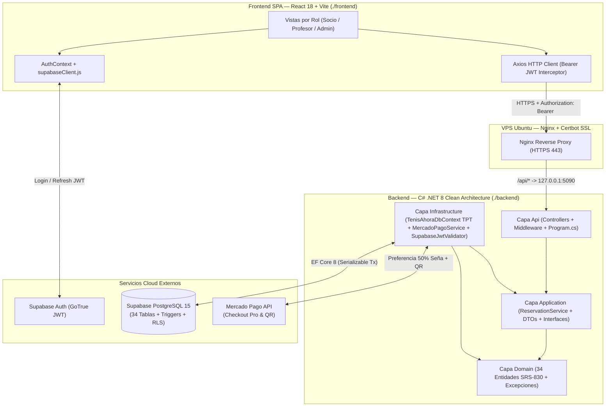
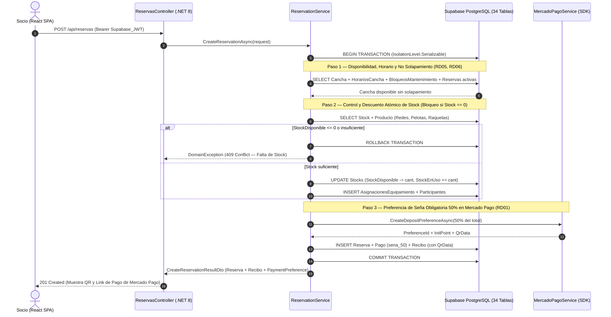

# 🎾 Club Tenis Ahora — Sistema Integral de Gestión Deportiva (IEEE SRS-830)


---

## 1. Descripción Ejecutiva y Evolución Arquitectónica

**Tenis Ahora** es una plataforma integral de gestión para clubes de tenis diseñada bajo los lineamientos de la especificación de requerimientos de software **IEEE SRS-830** (`RF001` a `RF142` y reglas de dominio `RD01` a `RD12`). El sistema centraliza la operación diaria del club para **Socios (`client`)**, **Profesores/Entrenadores (`coach`)** y **Personal Administrativo (`admin`)**:

- **Alquiler y Reserva de Canchas**: Grilla horaria interactiva por superficie (*Polvo de Ladrillo*, *Cemento*, *Pasto*), control de bloqueos por mantenimiento y asignación automática de equipamiento deportivo (*redes*, *pelotas*, *raquetas*).
- **Control Atómico de Inventario Deportivo**: Descuento en tiempo real al confirmar una reserva, bloqueo estricto cuando el stock disponible llega a cero (`0`) y restitución automática al finalizar o cancelar el turno.
- **Cobro de Señas del 50% con Mercado Pago**: Integración con el SDK oficial de Mercado Pago generando preferencias de pago, Links de Checkout y **Códigos QR interoperables** tanto para la seña obligatoria del 50% (`RD01`) como para la liquidación del 50% de saldo restante y la gestión de reembolsos por cancelación (`RD02-RD04`).
- **Competencias (Torneos y Ligas)**: Gestión de reglamentos oficiales con respaldo documental (PDF/JPG/PNG hasta 5 MB), cuadros de enfrentamientos (*brackets*), tablas de posiciones y control de cupos.
- **Academia, Clases Grupales, Entrenamientos y Turnos Particulares**: Validación de títulos habilitantes vigentes de los profesionales (`RD08-RD09`), límite reglamentario de 30 alumnos por clase (`RD07`) y planillas de asistencia.
- **Facturación, Recibos, Descuentos y Reembolsos**: Emisión de comprobantes oficiales con código QR verificable, facturas y notas de reintegro total o parcial.

### Resumen de la Migración Tecnológica

| Componente | Prototipo Legacy (Referencia de Solo Lectura) | Nueva Arquitectura de Producción |
| :--- | :--- | :--- |
| **Backend API** | Go (`net/http`) en `./server-a85c104e11a2d3d2a6454c189db7fd41c3f84859` | **C# .NET 8 Web API** con **Clean Architecture** en `./backend` |
| **Persistencia** | SQLite local (`tenis_ahora.db` — 14 tablas con JSON embebido) | **Supabase PostgreSQL 15** + **EF Core 8 (Npgsql)** — **34 tablas físicas normalizadas con herencia TPT** |
| **Autenticación y Autorización** | JWT local HS256 | **Supabase Auth (JWT Bearer)** + **Row Level Security (RLS)** en las 34 tablas + RBAC en .NET 8 |
| **Pasarela de Pagos** | Simulación en memoria | **Mercado Pago SDK Oficial (`mercadopago-sdk`)** — Preferencias, Links de Pago y QR |
| **Frontend** | SPA React con estado mixto | **React 18 + Vite 6 + TailwindCSS + Axios Interceptors** en `./frontend` |
| **Infraestructura** | Ejecución manual local | **Docker Multi-Stage Alpine + Nginx Reverse Proxy + Certbot SSL** |

---

## 2. Arquitectura del Sistema

### 2.1 Diagrama de Componentes (Clean Architecture)



### 2.2 Flujo Transaccional Atómico de Reserva (`IsolationLevel.Serializable`)



---

## 3. Modelo de Dominio Completo (6 Módulos / 34 Tablas Físicas — Herencia TPT)

El modelo de datos implementa las **33 entidades de dominio** especificadas en el documento **IEEE SRS-830** más la tabla relacional de unión `clientes_descuentos` (**34 tablas físicas en PostgreSQL y 34 clases en C#**).

Para las dos jerarquías de generalización/especialización del dominio se utiliza la estrategia **TPT (Table-Per-Type)** tanto en PostgreSQL (mediante claves primarias compartidas `PK/FK 1:1`) como en **Entity Framework Core 8** (`.UseTptMappingStrategy()`):
1. **Jerarquía de Usuarios (Módulo 1)**: La tabla base `public.usuarios` ([`Usuario`](backend/Domain/Entities/Usuario.cs)) almacena las credenciales, rol y datos personales comunes, mientras que las tablas derivadas `public.clientes` ([`Cliente`](backend/Domain/Entities/Cliente.cs)), `public.administradores` ([`Administrador`](backend/Domain/Entities/Administrador.cs)) y `public.profesionales` ([`Profesional`](backend/Domain/Entities/Profesional.cs)) comparten la misma clave primaria `id` y almacenan los atributos específicos de cada subtipo.
2. **Jerarquía de Actividades Grupales (Módulo 5)**: La tabla base `public.actividades_grupales` ([`ActividadGrupal`](backend/Domain/Entities/ActividadGrupal.cs)) modela los atributos comunes (cancha, profesional, cupo máximo <= 30, horario y tarifa), mientras que `public.clases` ([`Clase`](backend/Domain/Entities/Clase.cs)) y `public.entrenamientos` ([`Entrenamiento`](backend/Domain/Entities/Entrenamiento.cs)) extienden el supertipo mediante TPT.

### Catálogo de las 34 Entidades por Módulo

| Módulo | # | Entidad C# (`backend/Domain/Entities/`) | Tabla Física en Supabase (`public.*`) | Rol / Reglas SRS-830 Implementadas |
| :--- | :---: | :--- | :--- | :--- |
| **Módulo 1: Usuarios y Accesos** | 1 | [`Usuario.cs`](backend/Domain/Entities/Usuario.cs) | `public.usuarios` | **Supertipo TPT**. Vínculo `auth_user_id` con `auth.users`, DNI único, email y rol (`admin`, `client`, `coach`). |
| | 2 | [`Cliente.cs`](backend/Domain/Entities/Cliente.cs) | `public.clientes` | **Subtipo TPT (`: Usuario`)**. N° de socio (`TA-XXXX`), categoría, estado financiero y contador de reservas. |
| | 3 | [`Administrador.cs`](backend/Domain/Entities/Administrador.cs) | `public.administradores` | **Subtipo TPT (`: Usuario`)**. Legajo (`ADM-XXX`), cargo, sector y nivel de acceso. |
| | 4 | [`Profesional.cs`](backend/Domain/Entities/Profesional.cs) | `public.profesionales` | **Subtipo TPT (`: Usuario`)**. Matrícula, especialidad, tipo (`Profesor` / `Entrenador`), arancel por hora. |
| | 5 | [`Certificado.cs`](backend/Domain/Entities/Certificado.cs) | `public.certificados` | Título habilitante oficial del profesional con fecha de vencimiento y documento digital (`RD08`, `RD09`). |
| | 6 | [`HorarioProfesional.cs`](backend/Domain/Entities/HorarioProfesional.cs) | `public.horarios_profesional` | Franjas de disponibilidad semanal de cada profesional para clases y turnos particulares. |
| **Módulo 2: Canchas e Infraestructura** | 7 | [`TipoCancha.cs`](backend/Domain/Entities/TipoCancha.cs) | `public.tipos_cancha` | Catálogo de superficies (*Ladrillo*, *Cemento*, *Pasto*), velocidad, tarifa base y cupo máximo (`<= 30`). |
| | 8 | [`Cancha.cs`](backend/Domain/Entities/Cancha.cs) | `public.canchas` | Cancha física del club, superficie, precio por hora y estado (`disponible`, `ocupada`, `mantenimiento`). |
| | 9 | [`HorarioCancha.cs`](backend/Domain/Entities/HorarioCancha.cs) | `public.horarios_cancha` | Horario de apertura y cierre por día de la semana (`RF016-RF019`). |
| | 10 | [`BloqueoMantenimiento.cs`](backend/Domain/Entities/BloqueoMantenimiento.cs) | `public.bloqueos_mantenimiento` | Bloqueos programados por reacondicionamiento o torneos (`RD06`). |
| **Módulo 3: Reservas e Inventario** | 11 | [`PoliticaReserva.cs`](backend/Domain/Entities/PoliticaReserva.cs) | `public.politicas_reserva` | Parámetros reglamentarios: duración máx. 2 hs, antelación máx. 30 días, seña 50%, ventana gratuita 6 hs (`RD01-RD05`). |
| | 12 | [`Producto.cs`](backend/Domain/Entities/Producto.cs) | `public.productos` | Catálogo SKU de materiales deportivos (`Redes`, `Pelotas`, `Raquetas`, `Accesorios`). |
| | 13 | [`Stock.cs`](backend/Domain/Entities/Stock.cs) | `public.stocks` | Existencias físicas (`stock_total`, `stock_disponible`, `stock_en_uso`) con invariante `total = disponible + en_uso`. |
| | 14 | [`Reserva.cs`](backend/Domain/Entities/Reserva.cs) | `public.reservas` | Turno reservado, costos, seña del 50%, saldo pendiente y auditoría de cancelación. |
| | 15 | [`AsignacionEquipamiento.cs`](backend/Domain/Entities/AsignacionEquipamiento.cs) | `public.asignaciones_equipamiento` | Desglose relacional de productos/stocks asignados a una reserva y estado de devolución (`en_uso` / `devuelto`). |
| | 16 | [`Participante.cs`](backend/Domain/Entities/Participante.cs) | `public.participantes` | Jugadores registrados en el turno (2 en *singles*, 4 en *dobles*) con identificación del socio titular. |
| **Módulo 4: Competencias (Torneos y Ligas)** | 17 | [`TipoCompetencia.cs`](backend/Domain/Entities/TipoCompetencia.cs) | `public.tipos_competencia` | Formatos oficiales (*Eliminación Directa*, *Round Robin*, *Liga Anual*) y sistema de puntuación (`RF061-RF065`). |
| | 18 | [`Reglamento.cs`](backend/Domain/Entities/Reglamento.cs) | `public.reglamentos` | Texto normativo y archivo adjunto PDF/JPG/PNG (`<= 5 MB`) del reglamento interno (`RF041`, `RF048`). |
| | 19 | [`Competencia.cs`](backend/Domain/Entities/Competencia.cs) | `public.competencias` | Torneo o Liga del club, fechas, categoría, cupo máximo, costo de inscripción y premios. |
| | 20 | [`Equipo.cs`](backend/Domain/Entities/Equipo.cs) | `public.equipos` | Dupla o equipo participante y sus estadísticas en tabla de posiciones (`PJ`, `PG`, `PP`, `SF`, `SC`, `Puntos`). |
| | 21 | [`InscripcionCompetencia.cs`](backend/Domain/Entities/InscripcionCompetencia.cs) | `public.inscripciones_competencia` | Inscripción de socio (y compañero en dobles) validando no duplicidad de DNI y cupo disponible. |
| | 22 | [`Enfrentamiento.cs`](backend/Domain/Entities/Enfrentamiento.cs) | `public.enfrentamientos` | Partido programado en ronda/jornada, cancha asignada, marcador (`score`) y ganador (`RF057-RF058`). |
| **Módulo 5: Academia y Clases** | 23 | [`ActividadGrupal.cs`](backend/Domain/Entities/ActividadGrupal.cs) | `public.actividades_grupales` | **Supertipo TPT**. Cancha, profesional habilitado obligatorio, horario, cupo (`<= 30`, `RD07`) y arancel mensual. |
| | 24 | [`Clase.cs`](backend/Domain/Entities/Clase.cs) | `public.clases` | **Subtipo TPT (`: ActividadGrupal`)**. Nivel pedagógico, rango etario, objetivos técnicos y pelotas por sesión. |
| | 25 | [`Entrenamiento.cs`](backend/Domain/Entities/Entrenamiento.cs) | `public.entrenamientos` | **Subtipo TPT (`: ActividadGrupal`)**. Intensidad física, enfoque táctico y requerimiento de apto médico. |
| | 26 | [`InscripcionActividad.cs`](backend/Domain/Entities/InscripcionActividad.cs) | `public.inscripciones_actividad` | Inscripción de alumno a una actividad grupal con control de cupo máximo. |
| | 27 | [`Asistencia.cs`](backend/Domain/Entities/Asistencia.cs) | `public.asistencias` | Registro de asistencia por sesión (`P` Presente, `A` Ausente, `-` Sin dictar). |
| | 28 | [`TurnoParticular.cs`](backend/Domain/Entities/TurnoParticular.cs) | `public.turnos_particulares` | Clase individual/personalizada validando no solapamiento de alumno ni profesor. |
| **Módulo 6: Pagos, Facturación y Finanzas** | 29 | [`Descuento.cs`](backend/Domain/Entities/Descuento.cs) | `public.descuentos` | Beneficios y promociones parametrizables por porcentaje (`0-100%`) y rubro (`RF138-RF142`). |
| | 30 | [`ClienteDescuento.cs`](backend/Domain/Entities/ClienteDescuento.cs) | `public.clientes_descuentos` | Asignación N:M de descuentos activos a cada socio. |
| | 31 | [`Pago.cs`](backend/Domain/Entities/Pago.cs) | `public.pagos` | Transacción financiera (`sena_50`, `saldo_50`, `inscripcion`, `cargo_cancelacion`) + metadatos de Mercado Pago. |
| | 32 | [`Recibo.cs`](backend/Domain/Entities/Recibo.cs) | `public.recibos` | Comprobante oficial 1:1 con `Pago`, detalle de ítems, código QR y enlace de pago (`RF134-RF137`). |
| | 33 | [`Factura.cs`](backend/Domain/Entities/Factura.cs) | `public.facturas` | Comprobante fiscal emitido por administración (`FC-0001-XXXXXXXX`, `RF125-RF127`). |
| | 34 | [`Reembolso.cs`](backend/Domain/Entities/Reembolso.cs) | `public.reembolsos` | Devolución total o parcial vinculada a una cancelación de reserva (`RMB-AAAA-XXXX`, `RF131-RF133`). |

---

## 4. Reglas de Dominio (IEEE SRS-830) y Seguridad Row Level Security (RLS)

1. **Seña Obligatoria del 50% (`RD01`)**: Ninguna reserva se confirma sin el registro de una seña mínima del `50%` del valor total del turno, procesada a través de Mercado Pago (`PreferenceId`, `PaymentUrl` y `QrData`).
2. **Política de Cancelación y Reembolsos (`RD02`, `RD03`, `RD04`)**:
   - Si la cancelación se realiza con **6 horas o más de antelación** al inicio del turno (`horas_cancelacion_gratuita`), se emite un `Reembolso` **total** del 100% de la seña.
   - Si se cancela con **menos de 6 horas**, se aplica un cargo por cancelación tardía (`50%` de retención) con su correspondiente `Pago` y `Recibo`, y el remanente se acredita en un `Reembolso` **parcial** a favor del socio.
3. **Ventana de Reserva y Duración (`RD05`)**:
   - Duración permitida por turno: hasta **2 horas** (`120 minutos`).
   - Antelación máxima: hasta **30 días calendario** desde la fecha actual.
4. **No Solapamiento y Bloqueos de Cancha (`RD06`)**: Validación en capa de aplicación (transacción `Serializable`) y mediante el trigger PL/pgSQL `fn_validar_reglas_reserva()` impidiendo reservas en canchas en mantenimiento, fuera del horario de apertura/cierre o superpuestas con otra reserva activa.
5. **Bloqueo Estricto por Stock Cero**: Tanto [`ReservationService.cs`](backend/Application/Services/ReservationService.cs) como el trigger `fn_gestionar_stock_asignacion()` bloquean la reserva si `stock_disponible <= 0` o es inferior a la cantidad requerida de redes (`1`), tubos de pelotas (`1`) o raquetas (`2` en singles, `4` en dobles). Al finalizar o cancelar la reserva, el stock en uso se restituye automáticamente.
6. **Cupo Máximo y Certificación Docente (`RD07`, `RD08`, `RD09`)**: El trigger `fn_validar_cupo_y_profesor_actividad()` exige que toda actividad grupal tenga un profesional con certificado vigente (`estado = 'habilitado'`) y que el cupo nunca supere los **30 alumnos**.
7. **Seguridad Row Level Security (RLS) en las 34 Tablas**:
   - El script [`002_rls_security_policies.sql`](backend/supabase/migrations/002_rls_security_policies.sql) activa `ENABLE ROW LEVEL SECURITY` y `FORCE ROW LEVEL SECURITY` en las **34 tablas**.
   - **`admin`**: Acceso total (`ALL`) sobre las 34 tablas.
   - **`client`**: Lectura de catálogos públicos y acceso exclusivo a sus propios registros en `reservas`, `participantes`, `pagos`, `recibos`, `facturas`, `reembolsos`, `inscripciones_competencia` e `inscripciones_actividad`.
   - **`coach`**: Gestión de sus `horarios_profesional`, `certificados`, `actividades_grupales` asignadas, `asistencias` de sus alumnos y `turnos_particulares`.

---

## 5. Estructura del Repositorio

```text
tenias-ahora-app/
├── .antigravity/
│   └── skills/                                 # Reglas y guías arquitectónicas de agentes
├── backend/                                    # Backend Web API en C# (.NET 8 — Clean Architecture)
│   ├── Api/
│   │   ├── Controllers/
│   │   │   ├── AcademiaDocumentosController.cs # Profesores, Clases/Entrenamientos (TPT), Turnos Particulares y Documentos
│   │   │   ├── AuthUsuariosController.cs       # Login, Registro, Perfil (/yo), Usuarios, Socios y Descuentos asignados
│   │   │   ├── CajaPagosWebhookController.cs   # Recibos, Descuentos, Facturas, Reembolsos y Webhook de Mercado Pago
│   │   │   ├── CanchasStockController.cs       # Canchas, Tipos de Cancha, Stock/Productos y Configuración del Club
│   │   │   ├── CompetenciasController.cs       # Torneos, Ligas, Tipos de Competencia, Reglamentos, Inscripciones y Partidos
│   │   │   ├── HealthController.cs             # GET /api/health (Healthcheck Docker/Nginx)
│   │   │   └── ReservasController.cs           # CRUD + Pagar Saldo + Cancelar Reservas
│   │   └── Middleware/
│   │       └── ExceptionHandlingMiddleware.cs  # Mapeo uniforme de DomainException a JSON HTTP
│   ├── Application/
│   │   ├── DTOs/
│   │   │   └── ReservationDtos.cs              # Contratos de entrada/salida y Mercado Pago
│   │   ├── Interfaces/
│   │   │   ├── ICurrentUserService.cs
│   │   │   ├── IMercadoPagoGateway.cs
│   │   │   ├── IReservationService.cs
│   │   │   └── ISupabaseJwtValidator.cs
│   │   └── Services/
│   │       └── ReservationService.cs           # Orquestación atómica (Serializable)
│   ├── Domain/
│   │   ├── Entities/                           # 34 Entidades de Dominio (.cs individuales, TPT)
│   │   └── Exceptions/
│   │       └── DomainException.cs
│   ├── Infrastructure/
│   │   ├── Authentication/
│   │   │   ├── CurrentUserService.cs
│   │   │   └── SupabaseJwtValidator.cs         # Enriquecimiento de claims JWT con public.usuarios
│   │   ├── Payments/
│   │   │   └── MercadoPagoService.cs           # Integración con mercadopago-sdk (QR + Checkout)
│   │   └── Persistence/
│   │       └── TenisAhoraDbContext.cs          # EF Core 8 DbContext (34 DbSets + TPT Mapping)
│   ├── supabase/
│   │   └── migrations/
│   │       ├── 001_schema_core_and_domain_rules.sql  # DDL 34 tablas + TPT + Triggers PL/pgSQL
│   │       ├── 002_rls_security_policies.sql         # Políticas RLS para las 34 tablas
│   │       └── 003_seed_initial_data.sql             # Datos iniciales idempotentes (6 módulos)
│   ├── .dockerignore
│   ├── Dockerfile                              # Multi-stage build (.NET 8 SDK -> ASP.NET Alpine)
│   ├── deploy.sh                               # Script automatizado Docker + Nginx + Certbot SSL
│   ├── Program.cs                              # Configuración DI, Auth JWT Bearer, CORS y Swagger
│   ├── appsettings.json
│   └── TenisAhora.Api.csproj
├── frontend/                                   # Frontend SPA en React 18 + Vite + TailwindCSS
│   ├── src/
│   │   ├── auth/
│   │   │   ├── supabaseClient.js               # Cliente GoTrue REST para Supabase Auth
│   │   │   ├── jwt.js                          # Resolución de access_token / refresh_token
│   │   │   └── AuthContext.jsx                 # Estado global de sesión real y modo demo
│   │   ├── api/
│   │   │   ├── http.js                         # Cliente Axios + Interceptor Bearer JWT
│   │   │   ├── demo.js                         # Store en memoria para rutas /demo/*
│   │   │   └── index.js
│   │   ├── modulos/
│   │   │   ├── reservas/BookCourtPage.jsx      # Reserva en 3 pasos + QR y Link Mercado Pago
│   │   │   ├── caja/PaymentFlowModal.jsx       # Flujo de cobro QR / Tarjeta
│   │   │   └── caja/ReceiptModal.jsx           # Comprobante oficial imprimible con QR MP
│   │   └── ui/
│   │       ├── QRModal.jsx                     # Modal QR + Botón Checkout Mercado Pago
│   │       └── QRCode.jsx                      # Generador SVG de códigos QR (ISO 18004)
│   ├── package.json
│   └── vite.config.js
└── server-a85c104e11a2d3d2a6454c189db7fd41c3f84859/  # Prototipo original en Go (Solo lectura)
```

---

## 6. Guía de Instalación y Ejecución Local

### Requisitos Previos
- **.NET 8 SDK** (`8.0.x`)
- **Node.js** (`v20+`) y **npm**
- Proyecto en **Supabase** (PostgreSQL 15 + Supabase Auth)
- Credenciales de **Mercado Pago Developers** (`AccessToken` y `PublicKey` de prueba o producción)

### Paso 1: Configurar la Base de Datos en Supabase
1. Ingrese al **SQL Editor** de su proyecto en el Dashboard de Supabase.
2. Ejecute en orden estricto los tres scripts ubicados en `backend/supabase/migrations/`:
   1. [`001_schema_core_and_domain_rules.sql`](backend/supabase/migrations/001_schema_core_and_domain_rules.sql) — Crea las 34 tablas, relaciones TPT, índices y triggers PL/pgSQL.
   2. [`002_rls_security_policies.sql`](backend/supabase/migrations/002_rls_security_policies.sql) — Activa Row Level Security (RLS) y define las políticas por rol (`admin`, `client`, `coach`).
   3. [`003_seed_initial_data.sql`](backend/supabase/migrations/003_seed_initial_data.sql) — Carga el catálogo inicial de tipos de cancha, canchas, productos, stock, políticas, competencias, clases y usuarios de prueba.

### Paso 2: Configurar y Ejecutar el Backend (`.NET 8`)
1. Edite `backend/appsettings.json` (o defina variables de entorno) con las credenciales de su proyecto Supabase y Mercado Pago:
   ```json
   {
     "ConnectionStrings": {
       "SupabasePostgres": "Host=db.<PROYECTO>.supabase.co;Port=5432;Database=postgres;Username=postgres;Password=<DB_PASSWORD>;SSL Mode=Require;Trust Server Certificate=true"
     },
     "Supabase": {
       "Url": "https://<PROYECTO>.supabase.co",
       "Issuer": "https://<PROYECTO>.supabase.co/auth/v1",
       "Audience": "authenticated",
       "JwtSecret": "<SUPABASE_JWT_SECRET>"
     },
     "MercadoPago": {
       "AccessToken": "APP_USR-<TU_ACCESS_TOKEN>",
       "PublicKey": "APP_USR-<TU_PUBLIC_KEY>"
     }
   }
   ```
2. Compile y levante la Web API desde la carpeta `backend/`:
   ```bash
   cd backend
   dotnet restore
   dotnet build
   dotnet run
   ```
   - La API quedará escuchando en `http://localhost:5090` (Swagger UI disponible en `http://localhost:5090/swagger` y Healthcheck en `http://localhost:5090/api/health`).

### Paso 3: Configurar y Ejecutar el Frontend (`React + Vite`)
1. Cree un archivo `.env` dentro de `frontend/` (opcional si desea autenticar directamente contra Supabase Auth en la nube):
   ```env
   VITE_API_URL=http://localhost:5090/api
   VITE_SUPABASE_URL=https://<PROYECTO>.supabase.co
   VITE_SUPABASE_ANON_KEY=<SUPABASE_ANON_KEY>
   ```
2. Instale las dependencias e inicie el servidor de desarrollo:
   ```bash
   cd frontend
   npm install
   npm run dev
   ```
3. Para generar el build optimizado de producción:
   ```bash
   npm run build
   ```

---

## 7. Despliegue en Producción (VPS Ubuntu + Docker + Nginx + Certbot SSL)

El directorio `backend/` incluye todos los artefactos para desplegar la plataforma en una VPS **Ubuntu 22.04 / 24.04 LTS**:

- **[`backend/Dockerfile`](backend/Dockerfile)**: Compilación multi-etapa usando `mcr.microsoft.com/dotnet/sdk:8.0-alpine` (build) y `mcr.microsoft.com/dotnet/aspnet:8.0-alpine` (runtime ligero con usuario no-root `appuser`, soporte `icu-libs` para cultura `es-AR`, zona horaria `America/Argentina/Buenos_Aires` y `HEALTHCHECK` integrado).
- **[`backend/deploy.sh`](backend/deploy.sh)**: Script automatizado e idempotente en 5 etapas:
  1. Pre-chequeos y generación segura de `/etc/tenis-ahora/api.env`.
  2. Instalación de **Docker Engine** y configuración del firewall **UFW** (`OpenSSH`, `80/tcp`, `443/tcp`).
  3. Build de la imagen `tenis-ahora-api:latest` y ejecución del contenedor bindeado a loopback (`127.0.0.1:5090:5090`).
  4. Configuración de **Nginx** como servidor de la SPA (`frontend/dist`) y Proxy Inverso de `/api/` hacia `http://127.0.0.1:5090/api/` preservando la cabecera `Authorization: Bearer <Supabase_JWT>`.
  5. Emisión y renovación automática de certificados **SSL/TLS gratuitos (Let's Encrypt)** mediante **Certbot**.

```bash
# Ejecución en la VPS Ubuntu:
cd /opt/tenis-ahora/backend
chmod +x deploy.sh
sudo DOMAIN="tenisahora.club" ADMIN_EMAIL="admin@tenisahora.club" ./deploy.sh
```

---

## 8. Catálogo Completo de Endpoints REST de la API (`.NET 8`)

La capa `Api/Controllers/` expone paridad funcional del 100% con el cliente SPA (`frontend/src/api/http.js`), operando directamente sobre `TenisAhoraDbContext` y las 34 tablas físicas en Supabase PostgreSQL:

| Módulo / Controlador | Método | Ruta | Autenticación | Descripción y Reglas SRS-830 |
| :--- | :---: | :--- | :---: | :--- |
| **Salud (`HealthController`)** | `GET` | `/api/health` | Público | Estado de salud del servicio (`healthy`) y marca de tiempo UTC. |
| **Módulo 1: Auth, Usuarios y Socios (`AuthUsuariosController`)** | `POST` | `/api/auth/login` | Público | Autentica por correo/contraseña sobre `Usuario` (TPT), emite JWT HS256 y devuelve `{ token, user }`. |
| | `POST` | `/api/auth/registrar` | Público | Registra un nuevo `Cliente` (TPT) validando email y DNI únicos (`TA-XXXX`). |
| | `GET` | `/api/auth/yo` | `Bearer JWT` | Devuelve el perfil completo y claims del usuario autenticado. |
| | `GET` / `POST` / `PUT` / `DELETE` | `/api/usuarios` (`/api/usuarios/{id}`) | `Bearer JWT` | Padrón y ABM de usuarios con herencia TPT (`Cliente`, `Administrador`, `Profesional`). |
| | `GET` | `/api/socios` | `Bearer JWT` (`admin` / `coach`) | Lista el padrón de socios (`Cliente`) con sus descuentos activos. |
| | `PUT` | `/api/usuarios/{id}/descuentos` | `Bearer JWT` (`admin`) | Sincroniza la tabla relacional `clientes_descuentos` del socio (`RF138-RF142`). |
| **Módulos 2 y 3: Canchas, Stock y Config (`CanchasStockController`)** | `GET` / `POST` / `PUT` / `DELETE` | `/api/canchas` (`/api/canchas/{id}`) | `Bearer JWT` (`admin` en escritura) | Gestión de `Cancha` con sus `HorariosCancha` y `BloqueosMantenimiento`. |
| | `PATCH` | `/api/canchas/{id}/estado` | `Bearer JWT` (`admin`) | Actualiza el estado (`disponible`, `mantenimiento`, `ocupada`) y sincroniza bloqueos activos (`RD06`). |
| | `PUT` | `/api/canchas/{id}/disponibilidad` | `Bearer JWT` (`admin`) | Actualiza horarios de apertura/cierre y bloqueos programados de mantenimiento (`RF016-RF019`). |
| | `GET` / `POST` / `PUT` / `DELETE` | `/api/tipos-cancha` (`/api/tipos-cancha/{id}`) | `Bearer JWT` (`admin` en escritura) | Catálogo de superficies (`TipoCancha`), cupo máximo (`<= 30`) y bloqueo de borrado si está en uso. |
| | `GET` / `POST` / `PUT` / `DELETE` | `/api/stock` (`/api/stock/{id}`) | `Bearer JWT` (`admin` en escritura) | Inventario deportivo (`Producto` + `Stock`) con invariante `total = disponible + en_uso`. |
| | `PATCH` | `/api/stock/{id}/ajuste` | `Bearer JWT` (`admin`) | Ajusta el `StockTotal` validando `totalStock >= StockEnUso` y recalculando `StockDisponible`. |
| | `GET` | `/api/configuracion` | `Bearer JWT` | Devuelve la `PoliticaReserva` activa del club (`RD01-RD05`). |
| **Módulo 3: Reservas (`ReservasController`)** | `GET` | `/api/reservas` | `Bearer JWT` (`client` / `admin`) | Lista las reservas del socio autenticado o el padrón completo para el personal administrativo. |
| | `GET` | `/api/reservas/ocupacion` | `Bearer JWT` | Devuelve las franjas horarias ocupadas en todas las canchas sin exponer datos sensibles de otros socios. |
| | `POST` | `/api/reservas` | `Bearer JWT` (`client` / `admin`) | Ejecuta la transacción atómica `Serializable`: valida cancha, descuenta stock, crea preferencia del 50% en Mercado Pago y emite `Pago` + `Recibo` con QR. |
| | `PUT` | `/api/reservas/{id}` | `Bearer JWT` (`admin`) | Modifica cancha, fecha, horario o participantes recalculando costos y validando no solapamiento (`RF021`). |
| | `POST` | `/api/reservas/{id}/pagar-saldo` | `Bearer JWT` (`admin`) | Liquida el 50% de saldo pendiente al finalizar el partido, restituye el stock deportivo y emite el recibo final. |
| | `POST` | `/api/reservas/{id}/cancelar` | `Bearer JWT` (`client` / `admin`) | Cancela la reserva aplicando la política `RD02-RD04` (reembolso 100% si `>= 6 hs` o retención del 50% si `< 6 hs`) y restituye el stock. |
| **Módulo 4: Competencias (`CompetenciasController`)** | `GET` / `POST` / `PUT` / `DELETE` | `/api/tipos-competencia` (`/api/tipos-competencia/{id}`) | `Bearer JWT` (`admin` en escritura) | Formatos oficiales (`TipoCompetencia`) y reglas de puntuación (`RF061-RF065`). |
| | `GET` / `POST` / `PUT` / `DELETE` | `/api/torneos` y `/api/ligas` | `Bearer JWT` (`admin` en escritura) | Gestión integral de `Competencia` (`torneo` y `liga`), premios, cupos, equipos y partidos. |
| | `PUT` | `/api/torneos/{id}/reglamento` y `/api/ligas/{id}/reglamento` | `Bearer JWT` (`admin`) | Actualiza el `Reglamento` normativo y su documento digital adjunto (`RF041`, `RF048`). |
| | `POST` / `DELETE` | `/api/torneos/{id}/inscripciones` y `/api/ligas/{id}/inscripciones` | `Bearer JWT` (`client` / `admin`) | Inscribe o da de baja participantes validando cupo y DNI único, creando `Equipo`, `Pago` y `Recibo`. |
| | `POST` / `PUT` | `/api/torneos/{id}/enfrentamientos` y `/api/ligas/{id}/enfrentamientos` | `Bearer JWT` (`admin`) | Programa o reprograma partidos (`Enfrentamiento`) en rondas o jornadas. |
| | `POST` | `/api/ligas/{id}/enfrentamientos/{matchId}/resultado` | `Bearer JWT` (`admin`) | Registra marcador y ganador y recalcula la tabla de posiciones (`PJ`, `PG`, `PP`, `SF`, `SC`, `DIF`, `Puntos`). |
| **Módulo 5: Academia y Documentos (`AcademiaDocumentosController`)** | `GET` / `POST` / `PUT` / `DELETE` | `/api/profesores` (`/api/profesores/{id}`) | `Bearer JWT` (`admin` en escritura) | Gestión de `Profesional` (TPT), `Certificado` y `HorarioProfesional`. |
| | `PUT` | `/api/profesores/{id}/disponibilidad` y `/certificacion` | `Bearer JWT` (`coach` / `admin`) | Actualiza grilla horaria docente y título habilitante con validación de vigencia (`RD08`, `RD09`). |
| | `GET` / `POST` / `PUT` / `DELETE` | `/api/clases` (`/api/clases/{id}`) | `Bearer JWT` (`admin` en escritura) | Gestión TPT de `ActividadGrupal` (`Clase` y `Entrenamiento`) validando cupo `<= 30` (`RD07`, `RD10`) y certificado docente vigente (`RD09`). |
| | `POST` / `DELETE` | `/api/clases/{id}/alumnos` (`/alumnos/{studentDni}`) | `Bearer JWT` (`client` / `admin`) | Inscripción y baja de alumnos (`InscripcionActividad`) con control de cupo. |
| | `POST` | `/api/clases/{id}/asistencia/alternar`, `/sesion`, `/registrar` | `Bearer JWT` (`coach` / `admin`) | Gestión de planillas de `Asistencia` por sesión (`P`, `A`, `-`). |
| | `GET` / `POST` / `PUT` / `DELETE` | `/api/clases-particulares` y `/{id}/cancelar` | `Bearer JWT` | Gestión de `TurnoParticular` validando no solapamiento horario de profesor ni alumno. |
| | `POST` / `GET` | `/api/documentos` y `/api/documentos/{id}` | `Bearer JWT` (`POST`) / Público (`GET`) | Subida y descarga binaria de documentos PDF/JPG/PNG (`<= 5 MB`) con validación de magic bytes. |
| **Módulo 6: Caja, Facturación y Webhook (`CajaPagosWebhookController`)** | `GET` / `POST` | `/api/recibos` | `Bearer JWT` | Consulta y emisión de comprobantes oficiales (`Pago` + `Recibo` con QR). |
| | `GET` / `POST` / `PUT` / `DELETE` | `/api/descuentos` (`/api/descuentos/{id}`) | `Bearer JWT` (`admin` en escritura) | Catálogo de beneficios y promociones (`0 < porcentaje <= 100`, `RF138-RF142`). |
| | `GET` / `POST` | `/api/facturas` | `Bearer JWT` | Consulta y emisión de comprobantes fiscales `Factura` (`RF125-RF127`). |
| | `GET` / `POST` | `/api/reembolsos` | `Bearer JWT` | Consulta y emisión de notas de reintegro `Reembolso` (`RF131-RF133`). |
| | `POST` | `/api/pagos/webhook` | Público (Webhook MP) | Recibe notificaciones de Mercado Pago, concilia `Pago` (`aprobado`/`completado`), actualiza `Recibo` y confirma la `Reserva` asociada (`RD01`). |
